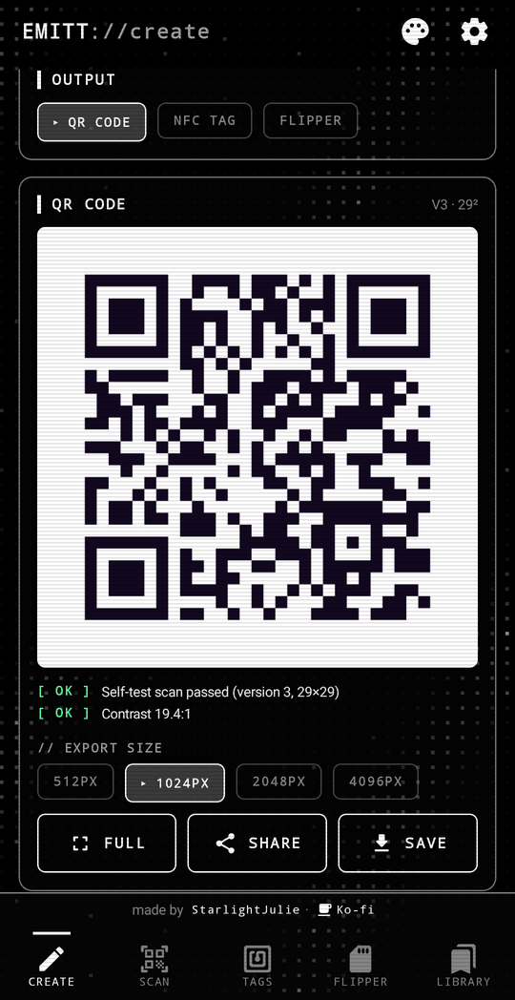
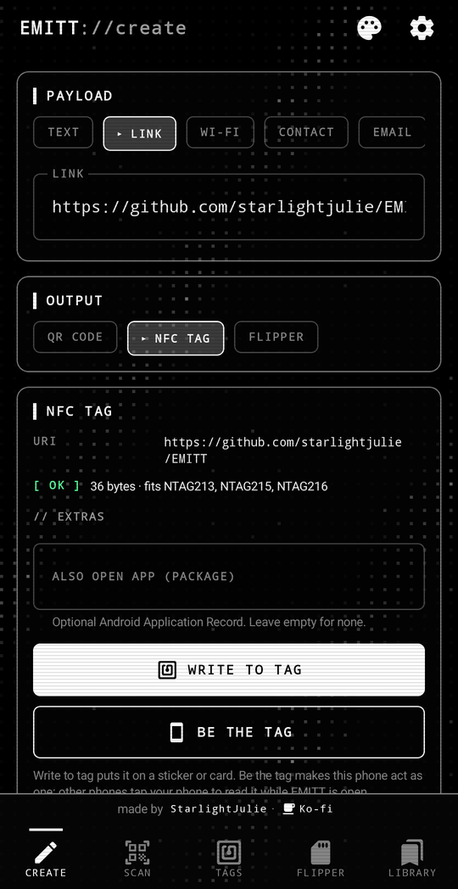
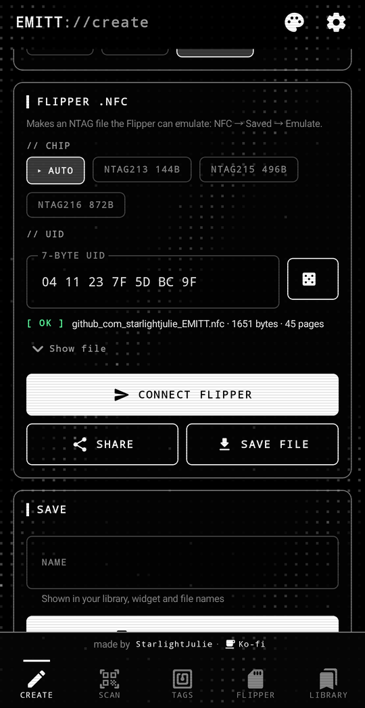
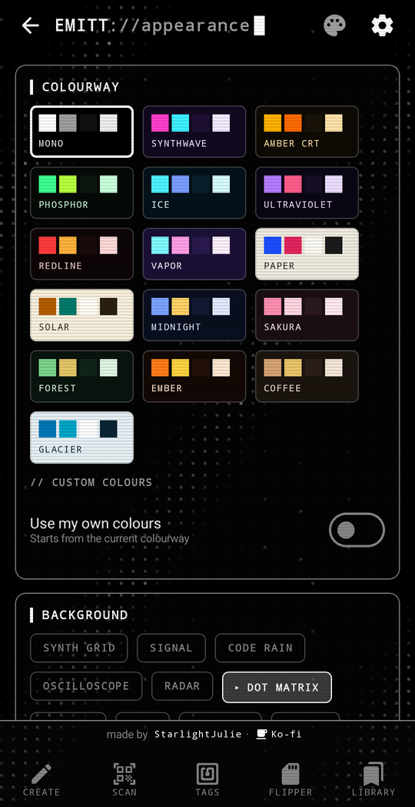
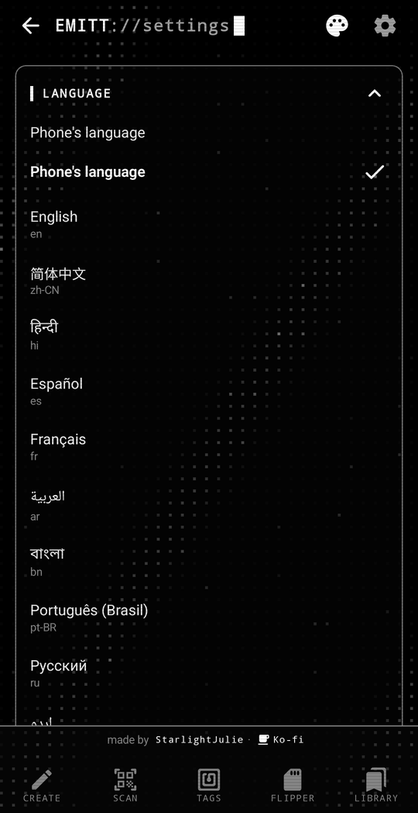

<div align="center">


# EMITT

**QR codes, NFC tags and Flipper Zero files from one app.**

Write a payload once, then emit it however you need: a styled QR code, a real NFC tag, or a `.nfc` file sent straight to your Flipper.

[Download](../../releases/latest) · [Changelog](CHANGELOG.md) · [Support on Ko-fi](https://ko-fi.com/vvanadium)

Free and open source · No ads, no tracking, no account · Works offline · 23 languages

<br />







</div>

---

## Install

1. Download `EMITT-x.y.z.apk` from the [latest release](../../releases/latest) on your phone.
2. Open it and allow your browser or file manager to install apps when Android asks.
3. That's it. EMITT tells you when a new version is out, and updates install over the top, keeping your library and settings.

Official builds are signed by me, and the About section in Settings says **Official build**. If it says otherwise, the copy didn't come from this page.

## What it does

### Create
One editor for **text, links, Wi-Fi, contacts, email, SMS, phone numbers, locations and Android apps**. Pick an output underneath it:

- **QR code**: styled, previewed and test-scanned as you type
- **NFC tag**: proper NDEF records (Wi-Fi tags use the WSC format Android joins automatically), with an optional "also open this app" record. Write it to a sticker or card, or tap **Be the tag** to make your phone act as the tag itself
- While you style a QR code, a small live preview floats in the corner so you can see each change
- **Flipper**: an NTAG213/215/216 file the Flipper can emulate, with a random or custom 7-byte UID. EMITT picks the smallest chip that fits.

### QR styling and visibility
- Module shapes: square, rounded, dots, fluid, bars, diamond, with adjustable module size
- Eye shapes: square, rounded, circle, leaf, with their own colours
- Flat, linear or radial gradients, and transparent backgrounds
- A centre badge: the EMITT mark, short text, or your own image
- Error correction (L/M/Q/H) and quiet zone controls
- **A self-test scan of every code**, plus contrast, inversion, border and density warnings, so you know it'll read before you print it
- Full-screen view at maximum brightness for showing codes to other phones
- Export as PNG up to 4096 px, share, or save to Pictures/EMITT

### Scan
Camera scanner for QR, Data Matrix, Aztec, PDF417 and common barcodes, or scan from an image. It runs fully on the phone with no Google Play Services. Anything you scan can be opened, copied, saved, or re-emitted as a tag or Flipper file.

### NFC tools
- **Read** any tag: chip type, UID, ATQA/SAK, memory used, every NDEF record, and a raw page dump for NTAG/Ultralight
- **Copy** a tag's data onto another, **erase** a tag, or **lock** it permanently (with a confirmation)
- **Import** a Flipper `.nfc` file and write its data to a real tag
- **Be the tag**: the phone emulates an NFC Forum Type 4 tag, so other phones (Android or iPhone) and Flippers read it like a sticker. A full-screen tag mode keeps EMITT in front, which matters on phones with a built-in tag service (such as Samsung's "Embedded tag"). It gets a random UID each tap, so it can't replace UID-based badges or door fobs
- **Testing with a Flipper**: to test Write to tag, emulate a blank NTAG on the Flipper (NFC → Add Manually → NTAG215 → Emulate). To read your phone, use NFC → Extra Actions → Read Specific Card Type → Type 4 Tag; plain Read also probes for payment cards, which wakes your wallet app

### Flipper Zero
- Pair over Bluetooth (enter the PIN from the Flipper's screen) and see device info and SD card space. Works with renamed Flippers and custom firmware like Momentum; close the official Flipper app's connection first, since the Flipper allows one
- **Send files straight to `/ext/nfc`**, list what's there, or make the Flipper beep to check the link
- Convert tags the phone reads into Flipper files (full memory for NTAG/Ultralight; UID/ATQA/SAK for others)
- Or share/save `.nfc` files and copy them over however you like

### Library, widget and tile
Save codes to a library with stars and search. Put any saved code on your **home screen as a widget**, or pin one to the **Quick Settings tile** (handy for your Wi-Fi) so it opens full screen in one tap.

### Make it yours
Everything lives under the palette icon at the top (**Appearance**):

- **16 colourways**: Mono (the default), Synthwave, Amber CRT, Phosphor, Ice, Ultraviolet, Redline, Vapor, Paper, Solar, Midnight, Sakura, Forest, Ember, Coffee and Glacier, or your own five colours
- **10 background animations**: synth grid, signal, code rain, oscilloscope, radar, dot matrix, circuit, warp, spectrum and static, each with speed, density, intensity and colour controls. Off by default
- CRT scanlines, vignette and flicker; glow; panel opacity and outlines; chamfered, sharp or soft corners; mono or mixed fonts; text size
- **10 launcher icons** to match: Amber, Synthwave, Phosphor, Cyan, Mono, Sakura, Redline, Ultraviolet, Paper and Glacier

### Languages
English, 简体中文, हिन्दी, Español, Français, العربية, বাংলা, Português (Brasil), Русский, اردو, Bahasa Indonesia, Deutsch, 日本語, Naijá (Nigerian Pidgin), العربية المصرية, मराठी, తెలుగు, Türkçe, தமிழ், 粵語（香港）, Italiano, Tiếng Việt and 한국어. EMITT follows your phone's language, or you can pick one in Settings → Language (on Android 13+ it's also in your phone's per-app language settings). Arabic and Urdu use a right-to-left layout. Flipper menu paths and chip names stay in English so they match your Flipper's screen.

Spotted a clumsy translation? Please open an issue with the language, the screen and a better wording.

### Vibration
Pick a pattern (tick, double tap, heartbeat, rising, purr and more, or off) separately for tag writes and reads, for being read as a tag, and for failures, with a strength slider.

### Updates
EMITT checks GitHub for new releases in the background (every 6 hours to 3 days, your choice) and sends a notification that opens the release page. It only asks GitHub's public API for the latest version and sends nothing about you. You can turn this off.

## Privacy

EMITT has no ads, analytics or accounts. Scanning, QR rendering and tag work all happen on your phone. The only network request it makes is the optional update check to GitHub.

Permissions are asked for when you first need them: the camera when you open Scan, Bluetooth when you connect a Flipper (Android 11 and older also need Location for Bluetooth scanning), and notifications once on first launch so update alerts can reach you. Saying no only switches off that one feature.

## Requirements

- Android 8.0 or newer
- NFC for the tag tools (QR and Flipper files work without it)
- Bluetooth LE for sending to a Flipper

## Building it yourself

<details>
<summary>For developers</summary>

You need JDK 17+ and the Android SDK (platform 36).

```bash
./gradlew assembleDebug
./gradlew testDebugUnitTest
```

Release builds look for a signing key in `keystore.properties` (project root or `~/.emitt-signing/`) or the `EMITT_KEYSTORE_*` environment variables, and fall back to the debug key otherwise.

Where things live:

| Path | What |
|---|---|
| `data/` | `Payload` model, `Encoding` (QR text formats and parsing), `Library`, `Settings`, `UpdateChecker` |
| `qr/` | `QrRenderer` (custom drawing on top of ZXing's encoder), `QrDecoder`, `QrStyle` |
| `nfc/` | `NdefCodec` (payload ↔ NDEF, Wi-Fi WSC), `TagOps` (write, read, erase, lock, NTAG dumps), `Type4Tag` + `EmulationService` + `Emulator` (phone as a tag) |
| `flipper/` | `FlipperNfcFile` (`.nfc` format v4), `FlipperProto` (hand-encoded RPC protobuf), `FlipperLink` (BLE serial, flow control, pairing) |
| `ui/` | Compose screens, `theme/` (colourways, `Backgrounds`, CRT overlay) |
| `data/Languages.kt`, `res/values-*/` | Language list and translations; `res/xml/locales_config.xml` registers them with Android |
| `tools/i18n/` | Source text for every language and the script that generates the `strings.xml` files (see its [README](tools/i18n/README.md)) |
| `widget/` | Home-screen widget, Quick Settings tile, full-screen code activity |
| `UpdateWorker.kt` | Background release check and notification |

</details>

## Support

EMITT is free and open source. If it's been useful to you, you can buy me a coffee on Ko-fi:

<a href="https://ko-fi.com/vvanadium"></a>

## Contributing

Bug reports and pull requests are welcome. For tag problems, please include the **tag type** (from the Tags screen) and your **phone model**. For Flipper problems, include the **firmware version** shown on the Flipper screen.

## License

EMITT is free and open source under the [GNU General Public License v3](LICENSE), with a few [additional terms](ADDITIONAL-TERMS.md). You're welcome to read the code, learn from it, build it yourself and improve it.

In short, if you share a modified version of EMITT:

- it has to stay open source under the same license,
- it has to keep my credit ("StarlightJulie", linking to my GitHub) in the code, the README and the About screen,
- it has to say clearly that it's modified and not the official release,
- and it needs its own name and icon, signed with your own key. The EMITT name and bracketed-emitter logo are for my official builds.

Please don't re-upload my releases to other stores or sites; link to this page instead.

It's built on these open-source projects:

- [ZXing](https://github.com/zxing/zxing) (Apache 2.0): QR encoding and barcode decoding
- [CameraX](https://developer.android.com/jetpack/androidx/releases/camera) (Apache 2.0)
- Jetpack Compose, Material 3, WorkManager, kotlinx.serialization (Apache 2.0)

The Flipper file format and RPC protocol follow Flipper Devices' public [firmware docs](https://github.com/flipperdevices/flipperzero-firmware/tree/dev/documentation/file_formats) and [protobuf definitions](https://github.com/flipperdevices/flipperzero-protobuf). Flipper Zero is a trademark of Flipper Devices Inc.; EMITT isn't affiliated with or endorsed by them.

Only write and emulate tags you own or have permission to use.
